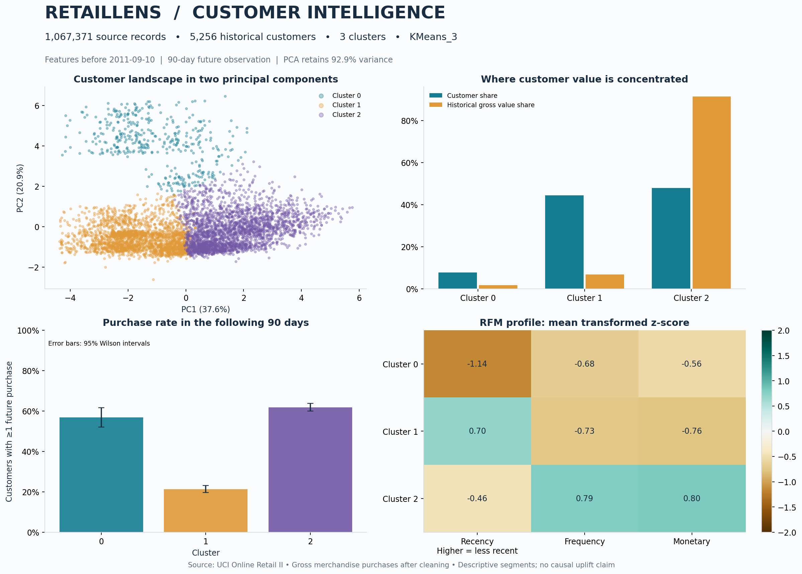

# RetailLens
### Customer segmentation and retention intelligence on 1.07M retail records

An executed, reproducible portfolio project using **SQL, Python, RFM, K-Means, hierarchical clustering, Gaussian mixtures and PCA**. Includes the original public dataset, fitted model, customer assignments, a notebook, charts, business analysis and hand-calculated validation tests.



## Verified results

| Measure | Result |
|---|---:|
| Original transaction line items | 1,067,371 |
| Historical customers modeled | 5,256 |
| Historical purchase invoices | 30,019 |
| Historical cleaned purchase lines | 618,314 |
| Selected solution | K-Means, 3 clusters |
| Silhouette, fixed sample of 1,500 customers | 0.323 |
| Mean ARI, five 80% customer subsamples | 0.965 |
| PCA | 10 features → 6 components, 92.9% variance |
| Future observation | 90 days |
| Validation tests | 12 passing |

**Read first:** [Business and methodology report](outputs/REPORT.md) · [Resume bullets](outputs/RESUME_BULLETS.md) · [Interview guide](docs/INTERVIEW_GUIDE.md).

## Business problem

Identify valuable repeat customers, recently observed customers and less-active customers; design distinct outreach hypotheses and evaluate whether historical groups exhibit different future purchasing behavior. The analysis separates unsupervised clusters from transparent RFM marketing personas. No fabricated retention, revenue or ROI improvements are claimed.

## Run locally

Use Python **3.12**. Extract the delivered archive, then run from its `customer_segmentation` folder:

```bash
python3.12 -m venv .venv
source .venv/bin/activate
python -m pip install -r requirements.txt
python -m unittest discover -s tests -v
python run.py
```

On Windows, activation is `.venv\Scripts\activate`. With conda, `conda create -n retaillens python=3.12` and `conda activate retaillens` can replace the venv steps.

The archive includes the original UCI download at `data/raw/online_retail_ii.zip`. The first run extracts and streams both workbook sheets into a SQLite database. Later runs reuse the database after checking the source checksum. If the archive is absent, the script downloads it from UCI. Installation requires internet; after dependency installation, the bundled data supports an offline run. First ingestion is slower than repeated model runs; runtime depends on the machine. All clustering is performed on customer rows, not a million line items.

### Notebook

Open `RetailLens_Walkthrough.ipynb` in Jupyter or VS Code with this project folder as the working directory. Its cells include actual recorded outputs from the delivered run. Run All reruns the analysis.

**Google Colab:** upload the notebook, then run its setup cell. If project files are absent it prompts you to upload the delivered ZIP; it extracts the project and installs pinned dependencies into an isolated environment. The notebook then runs the full project and displays the outputs. The Colab branch is provided but was not executed here; the local Python cells were executed. The archive is approximately 45 MB.

### Useful commands

```bash
# Recreate the ingestion database after changing cleaning logic.
python run.py --rebuild

# Use your local original UCI workbook.
python run.py --input /absolute/path/to/online_retail_II.xlsx

# Alternate historical snapshot; keep a separate output directory.
python run.py --cutoff 2011-08-01 --holdout-days 90 --output outputs_august

# Apply the saved model to an engineered customer feature table.
python score.py outputs/customer_segments.csv --output outputs/scored_customers.csv
```

Alternate runs overwrite `models/segmentation.joblib`; keep separate project copies if you want multiple models. Use the same historical observation-window policy for future customer scoring. The scoring script consumes customer-level features, not raw purchase rows, and does not recompute RFM personas. Joblib artifacts should only be loaded from trusted projects and matching package versions.

## Method

1. **Ingest and audit:** validate source columns; normalize types; deduplicate exact eight-column rows; log missing customer IDs, non-merchandise codes, invalid prices, returns and retained purchases.
2. **Set time boundary:** train on purchases before 10 September 2011; reserve 10 September–8 December inclusive for diagnostics. Exclude the incomplete final day.
3. **Engineer SQL features:** aggregate item rows into invoices, compute order gaps with `LAG`, choose the dominant country with `ROW_NUMBER`, and join order, product and return aggregates without duplicating customers.
4. **Prepare features:** historical median imputation, magnitude winsorization, log transforms and standardization; preserve raw values for reporting.
5. **Reduce dimensions:** fit PCA retaining ≥90% of variance; cluster using all retained components. The 2D chart is only a projection.
6. **Compare 21 candidates:** three model families × k=2–8; common silhouette sample, Davies–Bouldin and Calinski–Harabasz; K-Means elbow and GMM AIC/BIC diagnostics.
7. **Choose and stress-test:** maximize eligible silhouette under predeclared campaign-size constraints; refit selected family/k on five 80% samples to quantify partition sensitivity.
8. **Interpret and validate:** cluster profiles, rule-based RFM personas, untouched future purchasing and correctly censored monthly cohorts.

## Project layout

| Path | Purpose |
|---|---|
| `run.py` | Reproducible end-to-end command |
| `score.py` | Assign engineered customers using saved model |
| `src/data.py` | Streaming workbook ingestion, normalization, audit |
| `sql/customer_features.sql` | Actual feature SQL, joins and window functions |
| `src/features.py` | SQL execution, personas, holdout, cohort retention |
| `src/modeling.py` | Fitted preprocessing, PCA, model selection, stability |
| `src/reporting.py` | Charts, report and measured resume bullets |
| `tests/test_pipeline.py` | Hand-calculated accounting and leakage checks |
| `docs/DATA_DICTIONARY.md` | Definitions and assumptions |
| `docs/INTERVIEW_GUIDE.md` | Explanation and interview questions |
| `outputs/` | Actual outputs, CSVs, metrics and figures |
| `models/segmentation.joblib` | Fitted model and preprocessing |
| `data/raw/online_retail_ii.zip` | Original public dataset |

## Interpretation and limits

Cluster 0: recent/low-frequency group (406 customers; median recency 27 days). Cluster 1: less-active/low-frequency group (2,333; median recency 319 days). Cluster 2: established repeat/value group (2,517; median frequency 6 orders). These descriptions summarize medians, not every customer. Use `rfm_persona` for transparent marketing rules. Numeric cluster IDs are not stable across retraining.

The 1.07M figure counts raw **item-level records**, not orders or cleaned training rows. 'At risk' is an inactivity heuristic, not predicted churn. Revenue is gross merchandise spend, not profit or customer lifetime value. The data is historical, from a single UK retailer, with wholesale buyers; customer acquisition dates are unobserved. Strong internal separation or ARI does not establish incremental business impact. A controlled experiment is the next step.

## Source and licensing

Chen, D. (2012). *Online Retail II*. UCI Machine Learning Repository. https://doi.org/10.24432/C5CG6D. https://archive.ics.uci.edu/dataset/502/online+retail+ii . Data is **CC BY 4.0**; transformed outputs retain this attribution. Project code is MIT licensed. See `DATA_LICENSE.md` and `LICENSE`.

Reference implementation documentation: [scikit-learn clustering](https://scikit-learn.org/stable/modules/clustering.html) and [PCA](https://scikit-learn.org/stable/modules/generated/sklearn.decomposition.PCA.html). Installed versions are pinned in `requirements.txt`; runtime versions and source SHA-256 are recorded with the outputs.
