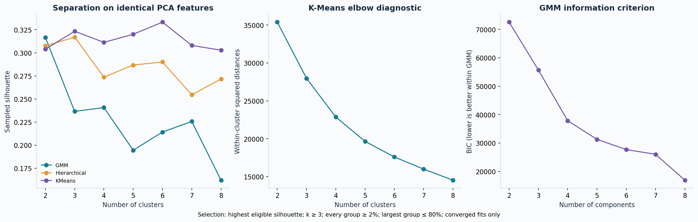
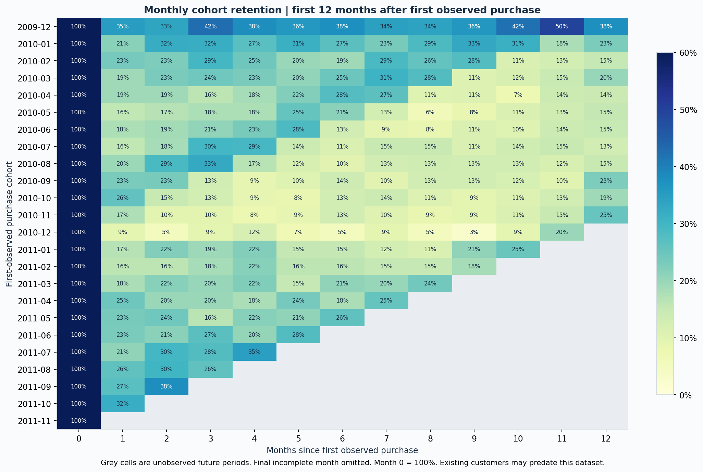

# RetailLens — Customer Segmentation & Retention Intelligence

## Executive result

Executed on **1,067,371 real source transaction records**, representing item-level rows, not distinct orders. After documented cleaning and the historical cutoff, the model covers **5,256 customers**, **30,019 purchase invoices** and **£13,690,824.94 gross merchandise value**.

The selected model is **KMeans_3**, with sampled silhouette **0.323** and mean 80%-subsample adjusted Rand index **0.965**. PCA reduces 10 modeled features to **6 components**, retaining **92.9%** variance. These are internal diagnostics, not accuracy or proof of business value.

Cluster 2 represents **47.9% of historical customers** and **91.4% of historical gross value**. The untreated holdout purchase rates below indicate differences in observed future behavior. They do not measure an intervention effect.

## Problem and intended use

A retailer needs to prioritize retention outreach, recognize valuable repeat buyers, and tailor campaigns without manually inspecting a million purchase rows. This project builds interpretable customer groups and exports actionable customer lists. Campaign strategies are proposals that require randomized testing.

## Data provenance and audit

Source: Daqing Chen (2012), Online Retail II, UCI Machine Learning Repository, DOI: https://doi.org/10.24432/C5CG6D. Dataset: https://archive.ics.uci.edu/dataset/502/online+retail+ii. CC BY 4.0: https://creativecommons.org/licenses/by/4.0/ . Original source preserved in the project download archive; transformed outputs are derived works. Source SHA-256: `bcbe73b35f5b7babf197fb0cb983a11f5d9ff929078d4aa53d171b1f2df2e980`.

Source dates: 2009-12-01 07:45:00 to 2011-12-09 12:50:00. Raw rows: 1,067,371. Exact normalized duplicates removed: 34,335. Deduplicated rows: 1,033,036.

| Disposition after deduplication | Rows |
|---|---|
| missing_customer | 235151 |
| non_merchandise_code | 3662 |
| nonpositive_price_or_zero_quantity | 60 |
| purchase | 776577 |
| return | 17586 |

Audit categories are mutually exclusive in priority order: invalid record → missing customer → non-merchandise code → nonpositive price/zero quantity → return → purchase. Missing descriptions remain usable if the product code is valid. Returns include C-prefixed invoices or negative quantities. Returns never count as purchase frequency. Gross value excludes returns; observed net value subtracts return magnitudes but is not reconciled accounting revenue. Refunds cannot always be matched to their original invoice. The product-code rule can omit legitimate unusual codes. Identical lines might be genuine repeat entries; exact-row deduplication is an explicit assumption.

## Time boundaries and leakage controls

- Historical features: timestamps strictly before **2011-09-10 00:00**.
- Holdout: **2011-09-10** inclusive to **2011-12-09** exclusive (90 days).
- The final source date is incomplete and excluded from validation.
- Customers first appearing during the holdout are excluded from historical-customer evaluation.
- Imputation, winsorization, scaling, PCA, clustering and persona thresholds use historical features only.
- Holdout outcomes are joined only after cluster selection; they never select the model.
- Monthly cohorts are descriptive over observed full months and are not modeling inputs.

## Features and transformations

SQL aggregates lines into orders, uses LAG for time between purchases and ROW_NUMBER for sequence/country selection, then joins customer, product and return aggregates. Frequency is invoice count, not row count. Monetary value is sum(quantity × unit price) over retained positive purchases, in GBP. Recency is calendar days from last purchase to the exclusive cutoff.

The 10 model inputs are: recency, frequency, monetary, unique_products, avg_basket_units, customer_age_days, avg_gap_days, return_value_ratio, recent_order_share, single_order. Additional descriptive fields include average order value, active months, purchase span, return value, observed net value, country and first-observed cohort. Country and identifiers are not clustering inputs.

Average gap is missing for one-order customers. The historical median fills it; the single-order indicator retains that information. Seven nonnegative magnitude features are capped at historical 1st/99th percentiles and log1p transformed. Refund ratio is log1p transformed; flags and shares are not percentile-capped. All inputs are standardized. Raw values remain unchanged in the customer export. Correlated RFM/behavior features can affect distance weighting; the correlation plot and an RFM-only partition comparison are supplied. PCA preserves variance, not guaranteed business relevance.

## Model comparison and selection

All models use the same customers, the same PCA representation and the same fixed random sample of 1,500 customers for silhouette. All customers are used for fitting, Calinski–Harabasz and Davies–Bouldin. Full-covariance GMM uses three initializations; K-Means uses twenty. Ward hierarchical clustering is computed on all historical customers.

Highest sampled silhouette among converged k>=3 candidates, min share>=2%, max share<=80%; k=2 benchmark only. The campaign use case requires at least three groups; k=2 is still reported. This business constraint is not a mathematical optimum. Elbow is a diagnostic for K-Means; AIC/BIC are GMM-only diagnostics. Selection does not claim a uniquely correct number of clusters.

| candidate | silhouette | davies_bouldin | smallest_cluster_share | eligible |
|---|---|---|---|---|
| KMeans_3 | 0.323 | 1.145 | 0.077 | True |
| Hierarchical_3 | 0.317 | 0.981 | 0.057 | True |
| KMeans_4 | 0.311 | 1.161 | 0.077 | True |
| Hierarchical_6 | 0.290 | 1.271 | 0.047 | True |
| Hierarchical_5 | 0.287 | 1.248 | 0.047 | True |
| Hierarchical_4 | 0.274 | 1.200 | 0.057 | True |
| Hierarchical_7 | 0.255 | 1.223 | 0.047 | True |
| GMM_4 | 0.241 | 2.448 | 0.077 | True |
| GMM_3 | 0.237 | 1.608 | 0.300 | True |
| GMM_7 | 0.226 | 1.709 | 0.037 | True |
| GMM_6 | 0.214 | 1.651 | 0.037 | True |
| GMM_5 | 0.195 | 2.585 | 0.037 | True |
| GMM_8 | 0.162 | 1.915 | 0.037 | True |
| KMeans_6 | 0.333 | 1.101 | 0.013 | False |
| KMeans_5 | 0.320 | 1.052 | 0.014 | False |
| GMM_2 | 0.317 | 1.515 | 0.359 | False |
| KMeans_7 | 0.308 | 1.056 | 0.012 | False |
| Hierarchical_2 | 0.307 | 1.412 | 0.298 | False |
| KMeans_2 | 0.304 | 1.418 | 0.437 | False |
| KMeans_8 | 0.303 | 1.117 | 0.012 | False |
| Hierarchical_8 | 0.272 | 1.163 | 0.012 | False |

Subsampling stability: refit the selected family and k on five independent 80% customer samples in the fixed fitted feature space; compare with original assignments on overlapping customers using ARI. Values: 0.997, 0.975, 0.994, 0.965, 0.893. This checks cluster sensitivity conditional on preprocessing; it does not refit the entire preprocessing pipeline and is not a temporal stability estimate. Different subsamples use different random seeds. RFM-only K-Means versus selected partition ARI: **0.480**; this is agreement, not superiority.

## Interpretable cluster profiles

| cluster | customers | median_recency | median_frequency | median_monetary | gross_value | avg_return_value_ratio | median_products | customer_share | gross_value_share |
|---|---|---|---|---|---|---|---|---|---|
| 0 | 406 | 27.000 | 1.000 | 405.735 | 237,879.680 | 0.010 | 24.000 | 0.077 | 0.017 |
| 1 | 2333 | 319.000 | 1.000 | 320.690 | 937,075.410 | 0.029 | 19.000 | 0.444 | 0.068 |
| 2 | 2517 | 72.000 | 6.000 | 2,111.880 | 12,515,869.850 | 0.022 | 91.000 | 0.479 | 0.914 |

## Untouched future-period diagnostics

| cluster | customers | buyers | purchase_rate | avg_future_gross_value | total_future_gross_value | purchase_rate_ci_low | purchase_rate_ci_high |
|---|---|---|---|---|---|---|---|
| 0 | 406 | 231 | 0.569 | 491.183 | 199,420.280 | 0.520 | 0.616 |
| 1 | 2333 | 498 | 0.213 | 84.058 | 196,107.720 | 0.197 | 0.231 |
| 2 | 2517 | 1558 | 0.619 | 958.487 | 2,412,511.410 | 0.600 | 0.638 |

Purchase rate = customers with at least one retained positive purchase in the holdout / all historical customers in that group. Intervals are 95% Wilson intervals under a binomial approximation and are descriptive; they do not address model-selection uncertainty. Future gross value excludes returns. Overall historical-customer purchase rate: **43.5%**. Seasonality and wholesale behavior may drive differences.

## RFM personas and proposed actions

Personas are explicit rules applied alongside the learned clusters, not names invented for cluster IDs. Rule order: inactive ≥90 days and historical spend ≥75th percentile → at-risk high-value; other inactive ≥90 days → dormant/at-risk; recent ≤30 days with high spend and frequency ≥loyal threshold → high-value loyal; recent ≤60 days with that frequency → loyal repeat; one purchase and observed customer age ≤60 days → new/first purchase; recent ≤30 days and high spend → recent high-value; otherwise developing/occasional. High-spend threshold: £2,061.88; loyal frequency: 6.0 invoices. 'At risk' is a heuristic inactivity label, not a validated churn prediction.

| rfm_persona | customers | buyers | purchase_rate | avg_future_gross_value | total_future_gross_value | purchase_rate_ci_low | purchase_rate_ci_high |
|---|---|---|---|---|---|---|---|
| At-risk high-value | 398 | 212 | 0.533 | 595.276 | 236,919.920 | 0.484 | 0.581 |
| Developing / occasional | 826 | 471 | 0.570 | 477.216 | 394,180.740 | 0.536 | 0.604 |
| Dormant / at-risk | 2966 | 770 | 0.260 | 118.618 | 351,820.290 | 0.244 | 0.276 |
| High-value loyal | 507 | 448 | 0.884 | 2,737.538 | 1,387,931.710 | 0.853 | 0.909 |
| Loyal repeat | 366 | 285 | 0.779 | 1,006.050 | 368,214.240 | 0.733 | 0.818 |
| New / first purchase | 164 | 88 | 0.537 | 322.443 | 52,880.590 | 0.460 | 0.611 |
| Recent high-value | 29 | 13 | 0.448 | 554.894 | 16,091.920 | 0.284 | 0.625 |

| Persona | Proposed action | Experiment outcome | Guardrail |
|---|---|---|---|
| High-value loyal / loyal repeat | Early access or replenishment reminders | Incremental repeat purchase rate | Opt-outs, discount cost |
| At-risk high-value | Personalized win-back message | Incremental contribution margin | Contact complaints, margin |
| Dormant / at-risk | Low-cost reactivation test | Incremental reactivation | Suppression of unresponsive customers |
| New / first purchase | Onboarding and second-purchase prompts | 60-day second-purchase rate | Returns and excessive incentives |
| Developing / occasional | Relevant cross-sell recommendations | Incremental basket value | Returns and opt-outs |

Randomize eligible customers within persona into treatment/control, predefine one primary outcome and observation period, and compare incremental results. Margin requires cost data absent here. No retention, revenue, conversion or ROI uplift has been measured.

## Cohorts, reproducibility and limitations

Cohort month means first observed purchase, not verified acquisition. Month 0 is 100%; later cells divide active cohort customers by original cohort size. Grey/blank future cells are right-censored. The incomplete final calendar month is excluded. Data covers one historical UK retailer with wholesale customers; it does not represent current general e-commerce customers. Anonymous purchases are excluded from customer modeling, which can introduce selection bias. No demographics, product hierarchy, marketing exposure, profit margin or churn labels are available. Outliers and merchant-code assumptions should be reviewed for a live retailer.

The persisted model includes fitted preprocessing, PCA, metadata and assignment logic. K-Means/GMM support native predict; a selected hierarchical model uses a clearly labeled nearest-centroid approximation for new customers. Agreement between those prototypes and the fitted clustering is 99.9%; this is only relevant for the hierarchical approximation. Do not treat prototype assignment as exact Ward prediction. Retrain and reprofile after material drift; numeric cluster IDs are not stable across refits. Versions: {'python': '3.12.14', 'pandas': '2.2.3', 'numpy': '2.3.5', 'sklearn': '1.8.0'}. Seed: 42.

## Source documentation

- UCI dataset and license: https://archive.ics.uci.edu/dataset/502/online+retail+ii
- Clustering: https://scikit-learn.org/stable/modules/clustering.html
- PCA: https://scikit-learn.org/stable/modules/generated/sklearn.decomposition.PCA.html
